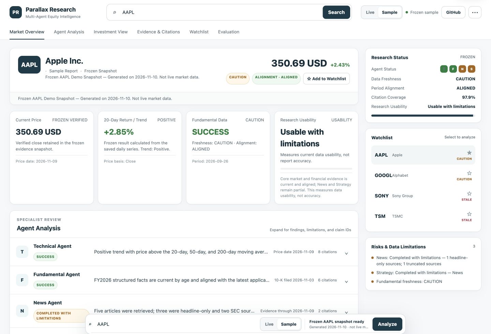
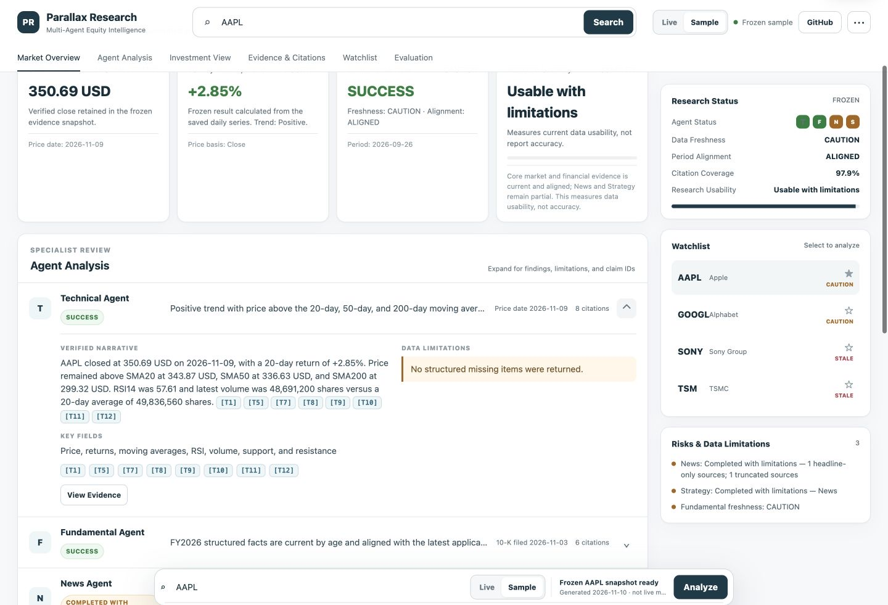
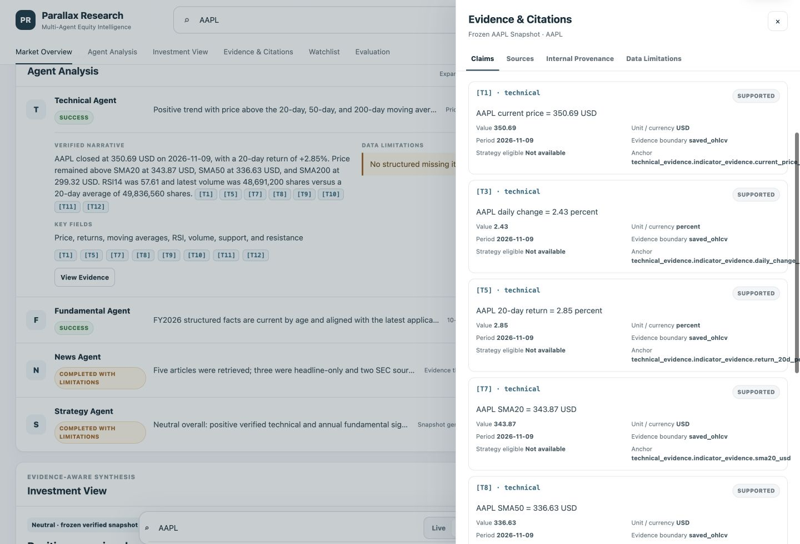
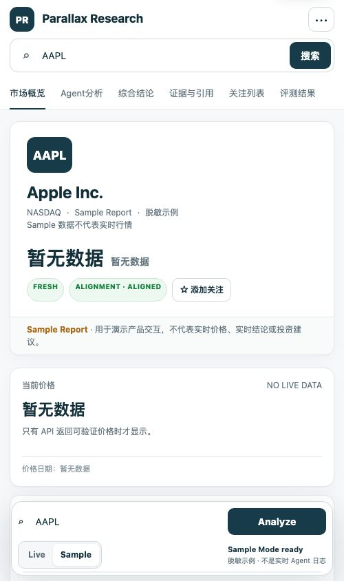
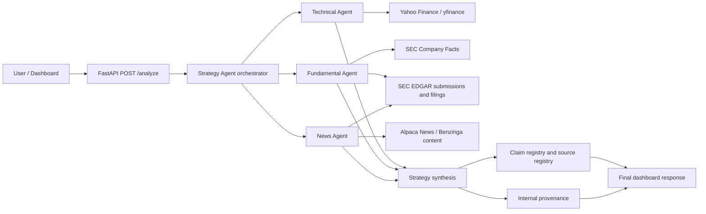

# Parallax Research

English | [简体中文](README.zh-CN.md)

**Evidence-aware multi-agent equity research for faster and more transparent investment analysis.**

> Enter a US stock ticker and receive a structured, evidence-aware research report generated by four specialized AI agents.

[Live Demo](https://parallax-stock-research.onrender.com/) · [GitHub Repository](https://github.com/christinezhao030816/us-stock-agent)

[](https://www.python.org/)
[](https://fastapi.tiangolo.com/)
[](https://openai.github.io/openai-agents-python/)
[](Dockerfile)
[](https://parallax-stock-research.onrender.com/)



Parallax Research is a multi-agent US equity research system that coordinates specialized Technical, Fundamental, News, and Strategy agents. It combines market data, SEC filings, and news evidence to produce structured investment research with claim-level citations, data-freshness checks, and explicit limitations.

I designed, built, evaluated, and iterated on this project from a real research workflow used in a student-managed investment fund. It is an AI Product Manager portfolio project—not a claim of production readiness or perfect accuracy.

## The problem

Equity research requires analysts to move between SEC filings, market data, technical charts, and news sources. A first-pass company review can take hours, while general-purpose LLM responses may use stale data, omit evidence, or present unsupported conclusions as facts.

Analysts need speed without giving up traceability.

## The solution

Parallax Research turns one ticker input into an evidence-aware research workflow:

- Parallel specialist analysis across technicals, fundamentals, and news
- A consolidated investment view from a Strategy Agent
- Claim-level citations linked to a source registry
- Financial freshness and latest-filing-period alignment checks
- Honest `partial` states when data is incomplete
- Visible headline-only, truncated, stale, and unavailable evidence
- Live Mode for the API and Sample Mode for reliable demonstrations

## Product experience

1. Search for a ticker.
2. Run the multi-agent analysis.
3. Review each specialist Agent and its status.
4. Inspect the consolidated investment view.
5. Open claims, sources, and internal provenance.
6. Identify stale, partial, headline-only, or truncated evidence.
7. Add companies to the Watchlist for quick comparison.

### Specialist analysis



### Evidence and citations



### Responsive mobile experience



Sample Mode is clearly labeled and never presents its packaged demonstration data as live market research. Live Mode calls the existing `/analyze` API and surfaces cold starts, timeouts, and upstream failures without fabricating progress logs.

## Multi-agent architecture



The Strategy Agent invokes the three specialist Agents as parallel tools. The specialists do not communicate directly with one another; their structured outputs return to Strategy for comparison and synthesis.

## Agent responsibilities

| Agent | Responsibility | Main evidence |
|---|---|---|
| Technical | Price trends, returns, moving averages, RSI, volume, support, and resistance | Reproducible daily OHLCV evidence from Yahoo Finance / yfinance |
| Fundamental | Financial statements, growth, cash flow, capital structure, and filing periods | SEC Company Facts, submissions, and filing documents |
| News | Recent events, relevance, duplication, source depth, and SEC events | Alpaca/Benzinga content and SEC filings |
| Strategy | Compare signals, identify conflicts, and summarize risks and catalysts | Inherited specialist claims only |

The Strategy Agent is not allowed to create new external facts, URLs, filing identifiers, or citation IDs.

## Evidence and trust design

Parallax Research treats evidence quality as part of the product experience, not as hidden implementation detail.

- **Claim-level IDs:** Technical, Fundamental, and News facts use stable markers such as `[T4]`, `[F2]`, and `[N7]`.
- **Source registry:** Each cited claim maps to its source name, URL, date, anchor, and evidence metadata.
- **Internal provenance:** System-derived results—such as Agent status, freshness, alignment, and usability—record their inputs, rule, result, and deterministic status separately from external citations.
- **Evidence boundaries:** News evidence is classified as `fully_supported`, `headline_only`, `truncated_source`, or `unavailable`.
- **Freshness:** Financial facts are checked against configurable age thresholds.
- **Latest-period alignment:** A fact can be recent by age but still trail a newer filing period.
- **Historical fallback:** Older structured facts may be shown for context, but they cannot be described as the latest period.
- **Partial status:** An Agent can return useful data while explicitly listing what is missing.
- **Deterministic gating:** Weak or unavailable news evidence cannot drive the core bull, bear, catalyst, risk, or final-investment conclusion.

This design makes a constrained answer more valuable than a confident but unsupported one.

## Research Usability

> **Research Usability measures whether the available data is sufficiently current and complete for present-day research. It is not an accuracy score.**

Calibration showed that the original confidence score correlated more strongly with current data usability than with factual or numerical errors. The product therefore separates two ideas:

1. **Content Verification** — whether facts, numbers, and citations are correct and traceable.
2. **Current Research Usability** — whether the available evidence is current and complete enough to support present-day analysis.

The dashboard never labels Research Usability as model accuracy.

## Evaluation results

### Evaluation stages

| Stage | Scope | Result |
|---|---|---|
| Early batch evaluation | 100+ companies across all 11 GICS sectors | Average analysis time of approximately **53 seconds** |
| Formal evidence-heavy Baseline v1 | 19 diverse stocks with frozen reports and evidence | **19/19 completed**; mean latency **≈75.8 seconds**; median latency **≈75.9 seconds** |

### Formal 19-stock Baseline v1

| Metric | Result |
|---|---:|
| External Factual Accuracy | **97.25%** |
| Numerical Accuracy | **98.43%** |
| Citation Accuracy | **97.07%** |
| External Citation Coverage | **93.52%** |
| Completeness | **99.34%** |
| Internal Traceability | **100%** |
| Technical Agent success | **19 / 19** |

These results describe the frozen 19-stock Baseline v1 only. They should not be generalized to every security or future data condition.

**Methodology:** Technical metrics were independently recomputed from saved OHLCV bars. Financial claims were checked against SEC evidence, reporting period, currency, and units. Citation coverage was evaluated from factual claims in the report body—not only from claims already registered by the system. Failures, unsupported claims, and partial results were retained rather than hidden.

The machine-readable rubric and independent runner are available in [`evaluation/final_evaluation_rubric_v3.json`](evaluation/final_evaluation_rubric_v3.json) and [`evaluation/final_evaluation_runner.py`](evaluation/final_evaluation_runner.py).

## Product iterations

| Phase | Product problem addressed |
|---|---|
| P0 | Correct financial amount scaling and unit errors |
| P1 | Normalize vendor-specific ticker formats and base Agent status on real data |
| P2 | Save raw bars, formulas, and reproducible technical evidence |
| P3 | Add claim-level citation traceability and a source registry |
| P4 | Detect stale financial facts and lag versus the latest applicable filing |
| P5 | Support IFRS taxonomy, reporting periods, and original currencies for foreign issuers |
| P6 | Introduce independent evaluation, claim-universe auditing, and confidence calibration |
| P7 | Improve numerical consistency and enforce news evidence boundaries |

## Technology stack

| Layer | Technology |
|---|---|
| Application | Python 3.13, FastAPI, Pydantic, Uvicorn |
| Agent orchestration | OpenAI Agents SDK |
| Data access | HTTPX, yfinance, Alpaca News, SEC EDGAR / Company Facts |
| Data processing | pandas, NumPy |
| Dashboard | Single-file HTML, CSS, and JavaScript |
| Deployment | Docker, Render |
| Testing and evaluation | pytest, deterministic regression tests, independent evaluation runners |

## Repository structure

```text
.
├── agents/                       # Technical, Fundamental, News, and Strategy Agents
├── tools/                        # Market, SEC, news, evidence, freshness, and status tools
├── evaluation/                   # Rubric v3, batch runners, and independent evaluators
├── tests/                        # Deterministic unit and regression tests
├── docs/
│   └── screenshots/              # Dashboard images used in this case study
├── static/                       # Static web assets retained by the FastAPI app
├── app.py                        # FastAPI orchestration and API response assembly
├── main.py                       # Command-line entry point
├── parallax_prototype.html       # Single-file Live / Sample interview dashboard
├── requirements.txt
├── Dockerfile
├── render.yaml
└── .env.example
```

## Quick start

### 1. Clone and install

```bash
git clone https://github.com/christinezhao030816/us-stock-agent.git
cd us-stock-agent

python3 -m venv .venv
source .venv/bin/activate
python -m pip install --upgrade pip
pip install -r requirements.txt
cp .env.example .env
```

On Windows PowerShell, activate the environment with `.venv\Scripts\Activate.ps1`.

### 2. Configure environment variables

The live analysis path uses these names from [`.env.example`](.env.example):

| Variable | Purpose |
|---|---|
| `OPENAI_API_KEY` | OpenAI model access |
| `ALPACA_API_KEY` | Alpaca market/news access |
| `ALPACA_SECRET_KEY` | Alpaca secret |
| `SEC_USER_AGENT` | SEC-compliant application name and contact |
| `APCA_API_KEY_ID` | Alternate Alpaca key name accepted by the news tool |
| `APCA_API_SECRET_KEY` | Alternate Alpaca secret name accepted by the news tool |
| `PORT` | Server port; defaults to `8000` in Docker |
| `ANALYSIS_RATE_LIMIT_PER_HOUR` | Per-client hourly request limit |
| `MAX_CONCURRENT_ANALYSES` | Maximum simultaneous analyses |

Never commit `.env` or secret values.

### 3. Run locally

```bash
uvicorn app:app --host 127.0.0.1 --port 8000
```

Open [http://127.0.0.1:8000](http://127.0.0.1:8000). The API health check is available at [http://127.0.0.1:8000/health](http://127.0.0.1:8000/health).

```bash
curl http://127.0.0.1:8000/health
```

For an offline interview demonstration, open `parallax_prototype.html` directly and use Sample Mode.

### 4. Run tests

```bash
PYTHONPATH=. python -m pytest -q
python -m compileall -q app.py agents tools evaluation tests
git diff --check
```

### 5. Run with Docker

```bash
docker build -t parallax-research .
docker run --env-file .env -p 8000:8000 parallax-research
```

## API example

`POST /analyze` accepts a ticker and an optional output language (`zh` or `en`):

```bash
curl -X POST http://127.0.0.1:8000/analyze \
  -H "Content-Type: application/json" \
  -d '{"symbol":"AAPL","language":"en"}'
```

Shortened response structure:

```json
{
  "symbol": "AAPL",
  "report": "# AAPL research report ...",
  "agent_statuses": {
    "technical": {"status": "success", "core_data_present": true},
    "fundamental": {"status": "partial", "core_data_present": true},
    "news": {"status": "partial", "core_data_present": true},
    "strategy": {"status": "partial", "core_data_present": true}
  },
  "technical_evidence": {},
  "citations": [],
  "source_registry": [],
  "citation_summary": {},
  "freshness_summary": {},
  "internal_provenance": []
}
```

The exact status depends on the data returned for that ticker. `partial` is a valid, visible outcome—not a hidden failure.

## Known limitations

- Some news sources provide only headlines, summaries, or truncated text.
- SEC Company Facts can lag the latest filed report.
- Recent structured IFRS facts may be unavailable for some foreign issuers.
- Historical fallback reduces current Research Usability even when older values are correct.
- One or more Agents may return `partial` when core evidence is incomplete.
- Multi-premise citation evaluation and some internal-provenance connections continue to be improved in Phase 7B.
- Outputs support research and education; they are not financial advice.

## Roadmap

- Separate Content Verification from Current Research Usability throughout the product.
- Strengthen multi-premise citation evaluation.
- Complete the English Live experience across every returned report path.
- Compare the next 19-stock benchmark with Baseline v1.
- Continue improving the public dashboard and product case-study presentation.

## Disclaimer

> This project is for research and educational purposes only. It does not provide investment advice or a recommendation to buy or sell securities.
