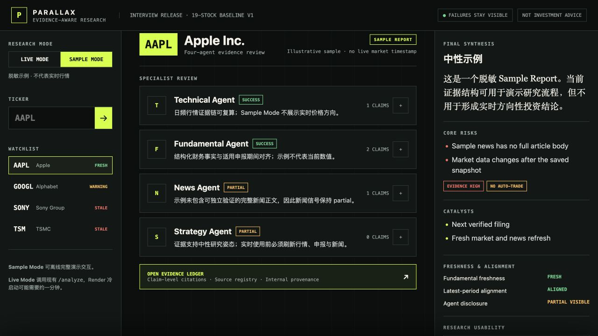
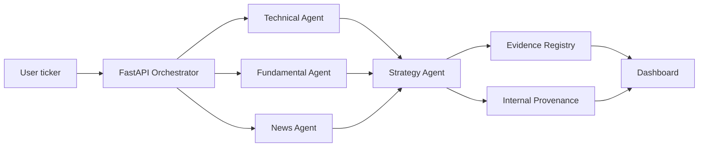
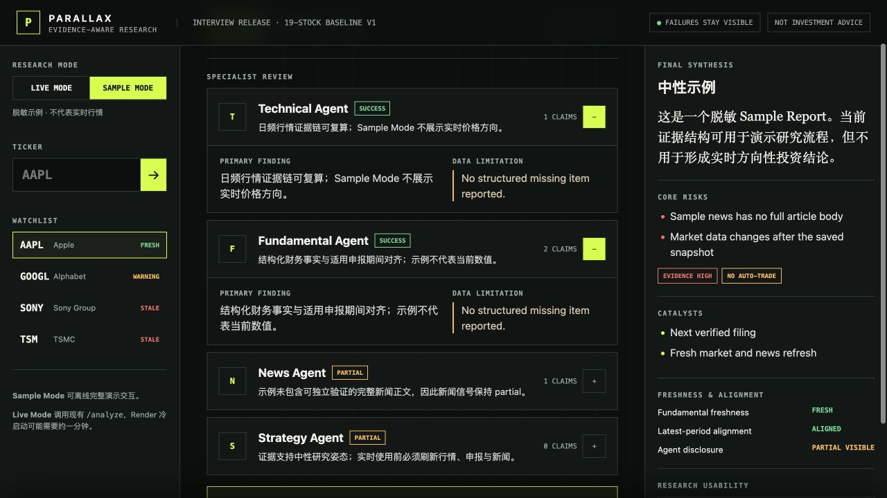
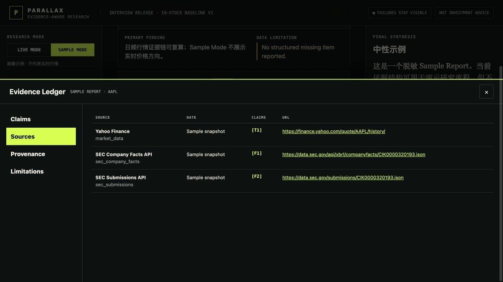

# PARALLAX · Evidence-aware U.S. Stock Research

> 输入一个美股 ticker，由 Technical、Fundamental、News 和 Strategy Agent 生成带证据、数据新鲜度与风险披露的研究报告。

[](./parallax_prototype.html)
[](#quick-start)
[](https://www.python.org/)

[Live Demo](https://parallax-stock-research.onrender.com) · [GitHub](https://github.com/christinezhao030816/us-stock-agent) · [Open local Dashboard](./parallax_prototype.html)

> **Sample Mode** 内置脱敏示例，不依赖 API 或网络，适合面试现场演示。页面始终明确标注 `Sample Report`，不会冒充实时数据。Render 免费实例可能冷启动；Live Mode 失败时可一键切换到 Sample Mode。



## Why this exists

### Problem

| 现实问题 | 常见后果 |
|---|---|
| 行情、财务、新闻和申报分散在不同来源 | 手工整理耗时，口径容易不一致 |
| 最新 filing 与结构化事实更新时间不同 | 旧数据可能被误写成“最新” |
| 普通 LLM 缺少可验证输入约束 | 可能生成无来源结论或扩大新闻含义 |
| 外国发行人使用 IFRS 与本币 | 期间、taxonomy、币种容易被混用 |

### Solution

- **四 Agent 架构**：Technical、Fundamental、News 独立取证，Strategy 只负责综合。
- **真实数据链路**：Yahoo/yfinance、SEC Company Facts / EDGAR、Alpaca News。
- **Claim-level citations**：重要事实映射到 `[Tn]`、`[Fn]`、`[Nn]`。
- **Freshness + alignment**：同时检查数据年龄与是否落后于最新适用申报。
- **IFRS support**：保留 taxonomy、concept、期间和 TWD/JPY 等原始币种。
- **Internal provenance**：系统评分、Agent 状态和数据限制拥有独立计算溯源。
- **Independent evaluation**：技术指标从 raw bars 独立复算，财务与新闻从冻结证据核验。

## Architecture



| Layer | Responsibility |
|---|---|
| Technical | 同一份日频 OHLCV 计算收益率、SMA、RSI、成交量和支撑阻力 |
| Fundamental | SEC/XBRL 指标选择、IFRS 映射、币种/期间保留、新鲜度判断 |
| News | 公司匹配、标题/正文边界、SEC filing 事件与来源质量 |
| Strategy | 继承专业 Agent 的事实与限制，输出风险、催化剂和综合判断 |
| Evidence | Source registry、claim citations、raw bars、internal provenance |

## Evaluation · Baseline v1

正式指标来自冻结的 **19-stock Baseline v1**，不是 Sample Mode，也不使用尚未验收的 Phase 7B 结果。

| Metric | 19-stock Baseline v1 |
|---|---:|
| External Factual Accuracy | **97.25%** |
| Numerical Accuracy | **98.43%** |
| Citation Accuracy | **97.07%** |
| Internal Traceability | **100%** |
| Technical Agent success | **19 / 19** |
| Mean latency | **≈ 75.8 s** |
| Median latency | **≈ 75.9 s** |

| Evaluation stage | Scope | Result |
|---|---|---|
| Early batch testing | 100+ companies | 平均约 **53 秒/公司**，用于发现稳定性和覆盖问题 |
| Formal Baseline v1 | 19 diverse stocks | 平均约 **75.8 秒**，中位约 **75.9 秒**；保存完整证据并独立评测 |

准确率、引用质量与完整度分别报告；项目不以一个“万能分数”掩盖失败案例。

## Quality iterations

| Phase | What changed |
|---|---|
| P0 | 修复财务金额单位与十倍换算错误 |
| P1 | 按数据源规范化 BRK.B 等 ticker，并基于真实数据判断 Agent 状态 |
| P2 | 保存 raw bars、公式和技术证据，实现独立复算 |
| P3 | 建立 claim-level citations 与 source registry |
| P4 | 加入 freshness 与 latest-period alignment，阻止旧数据冒充最新 |
| P5 | 支持外国发行人 IFRS taxonomy、原始币种和期间粒度 |
| P6 | 冻结 Rubric v3、独立 ground truth 与 Confidence calibration |
| P7 | 修复数值生成与 headline/truncated 新闻的 evidence boundary；仍在继续完善 |

## Product insight

Confidence calibration 带来一个关键结论：

> 旧 Confidence Score 更能解释 **Current Research Usability**（数据是否新、是否完整、Agent 是否 partial），而不能代表报告的事实准确率。

因此后续产品设计会拆成两个清晰维度：

1. **Content Verification** — 事实、数字、引用本身是否正确且可追溯。
2. **Current Research Usability** — 数据是否足够新、完整，并能支持当前投资研究。

Dashboard 右栏使用 `Research Usability`，不把 Confidence 命名为准确率。

## Dashboard

单文件 [`parallax_prototype.html`](./parallax_prototype.html) 无 CDN、远程字体或图片依赖，可直接双击打开。

- Live / Sample 双模式
- AAPL、GOOGL、SONY、TSM Watchlist
- 四 Agent 状态、结论、限制与引用数
- Fresh / Warning / Stale 和 latest-period alignment
- 风险、催化剂与 Research Usability
- 可展开的 Claim citations、Source Registry 和 Internal provenance
- Live API 冷启动提示、120 秒超时与一键 Sample fallback





## Known limitations

- 部分新闻源只能取得标题、摘要或截断正文；系统必须限制陈述范围。
- SEC Company Facts 的结构化事实可能晚于最新 filing。
- 外国发行人的最新 IFRS 结构化事实可能缺失，无法可靠提取时保持 partial。
- Phase 7B 仍在完善多事实句的逐前提引用，以及正文与 internal provenance 的连接。
- 这是研究辅助与工程作品集项目，**不是自动交易系统，也不构成投资建议**。

## Quick start

### 1. Local setup

```bash
git clone https://github.com/christinezhao030816/us-stock-agent.git
cd us-stock-agent
python3 -m venv .venv
source .venv/bin/activate
pip install -r requirements.txt
cp .env.example .env
```

配置 `.env`（不要提交）：

```dotenv
OPENAI_API_KEY=...
ALPACA_API_KEY=...
ALPACA_SECRET_KEY=...
SEC_USER_AGENT=YourName your_email@example.com
```

### 2. Run

```bash
uvicorn app:app --host 127.0.0.1 --port 8000
```

打开 `http://127.0.0.1:8000`。若只需无网络演示，可直接打开 `parallax_prototype.html` 并保持 Sample Mode。

### 3. Test

```bash
python -m pip install pytest
PYTHONPATH=. python -m pytest -q
python -m compileall -q app.py agents tools evaluation tests
git diff --check
```

### 4. Docker

```bash
docker build -t parallax-stock-research .
docker run --env-file .env -p 8000:8000 parallax-stock-research
```

## Repository map

```text
agents/       specialist and strategy Agent definitions
tools/        market, SEC, news, evidence, freshness and scoring tools
evaluation/   frozen rubrics, independent evaluators and regression runners
tests/        deterministic regression tests
app.py        FastAPI orchestration and /analyze response
parallax_prototype.html  single-file interview Dashboard
```

---

Built as an evidence-first AI research system: failures remain visible, partial data stays partial, and every metric is tied to a frozen evaluation definition.
